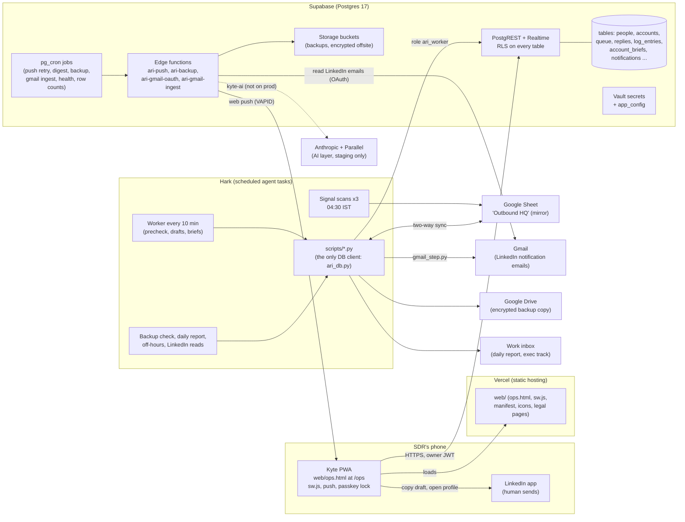
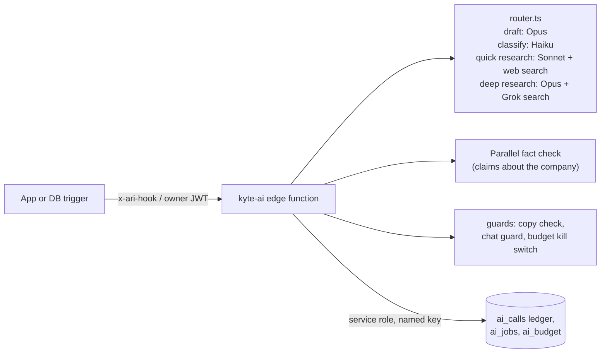
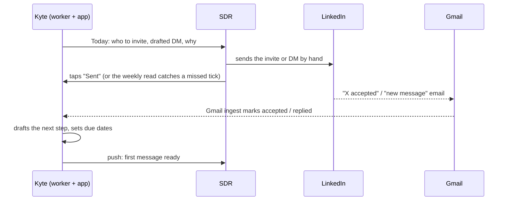

# Architecture

Kyte at its last live version (v18.14.10, Oct 30 2026). Diagrams are Mermaid, so GitHub draws them.

## The whole system

## The pieces

### Phone PWA (`web/ops.html` at `/ops`)
- One big HTML file (about 1.7 MB, 15k lines) plus `sw.js`, the manifest, fonts and icons. Installed to the home screen on Android and iPhone.
- Signs in with Google. The Google ID token (with a SHA-256 nonce) is exchanged for a Supabase session (`signInWithIdToken`). Only the owner's address is allowed.
- Reads Supabase directly over PostgREST as the signed-in owner, then keeps one Realtime channel open (people, accounts, queue, brief, log). An encrypted local cache paints instantly on open.
- Writes go through one RPC, `apply_op`, with an op id per tap, so outbox retries are idempotent. Offline taps queue in an outbox.
- Passkey lock (WebAuthn, platform authenticator) on every cold open and after time away.
- Web push through `sw.js` (VAPID). Tapping a push deep-links to `/ops?open=person:<id>` or `account:<uuid>`.
- Chat and "Ask" are not live AI on prod. A chat message becomes a Queue row (`action = Chat`) and the worker answers it on its next run, usually within 10 minutes.
- Frozen under `plans/base-lock.json` (private): only data-loss or security fixes, each deployed with `ARI_BASE_FIX='<reason>'`.

### Supabase
- **Projects:** one prod and one staging project. Staging got every migration first.
- **Roles:** `anon` (reads nothing; new objects are closed to it by default since 0016/0042), `authenticated` (the owner, checked by `is_owner()` pinned to one auth user id, and workspace members through `app.is_member()` since 0035), `ari_worker` (the scheduled worker; can run only the functions and table operations granted in 0018), `service_role` (edge functions, cron).
- **RLS:** on for every table. Owner policies, plus member policies since 0035, plus a few `ari_worker` policies.
- **Schema `app`:** `workspaces`, `memberships`, `pairings` (0033, 0045). One workspace existed. Every tenant table has `workspace_id`.
- **pg_cron jobs** (names kept from the Ari days):

| Job | Schedule (UTC) | What it does |
|---|---|---|
| `ari-push-retry` | `*/5 * * * *` | retries undelivered pushes |
| `ari-due-digest` | `30 15 * * *` (21:00 IST) | tonight's follow-ups push |
| `ari-weekly-digest` | weekly | weekly digest (written, not switched on) |
| `ari-nightly-backup` | `30 21 * * *` (03:00 IST) | starts `ari-backup` |
| `ari-gmail-ingest` | `*/10 * * * *` | starts `ari-gmail-ingest` |
| `ari-gmail-shadow-diff`, `ari-gmail-shadow-purge` | nightly | compare the email parser with the worker's results, purge old rows |
| `ari-health-alert` | `*/15 * * * *` | raises `ops_alert` pushes when something is stale |
| `ari-session-expiry` | `17 * * * *` | expires old sessions |
| `ari-rowcount-daily` | `30 2 * * *` (08:00 IST) | per-table row counts, alert on a drop over 10% |
| `ari-ai-events`, `ari-ai-prune` | 0041 | AI layer queue and prune (`ari-ai-events` paused on prod) |

- **Edge functions on prod:** `ari-push` (sends web push), `ari-backup` (nightly dump, restore test, encrypted copy), `ari-gmail-oauth` (connect Gmail, stores the refresh token in Vault), `ari-gmail-ingest` (reads LinkedIn notification emails). Verify JWT is off on all four; each checks its own caller with a hook secret header or a one-time ticket.
- **Prepared, never on prod:** `ari-worker-token` (R7 token broker), `ari-gmail-push` (Gmail Pub/Sub push), `kyte-ai` with legacy alias `ari-ai` (the AI layer), and named-key versions of the four live functions.

### Hark scheduled worker
- Hark runs agent tasks on a schedule. Each run is a fresh agent with its prompt, a shell in the project folder, and connector credentials. Prompts are in [tasks/](tasks/README.md).
- The worker never touches the database with SQL. It calls `scripts/*.py`, which go through `scripts/ari_db.py` as role `ari_worker`.
- **How auth reaches the scripts:** inside Hark, the sandbox's egress proxy injects `Authorization: Bearer <ari_worker JWT>` for the Supabase host (a saved binding), and the script sends the public publishable key as `apikey`. Outside Hark you set `ARI_SB_URL`, `ARI_SB_APIKEY` and `ARI_SB_JWT_FILE` instead. Google calls work the same way (the `gws` CLI with injected Google credentials).
- Overlap guard: `scripts/worker_lock.py` (a lock older than 25 minutes is taken over).

### Google Sheet mirror
- "Outbound HQ" started as the database and stayed as a mirror after v17. Tabs: People, Accounts, Queue, Emails, Brief (two-way, per field), Log (append-only, deduped by row hash), Book (Sheet to Supabase only).
- `scripts/sync_sheet_supabase.py` runs at the start of every worker run. Supabase wins a field changed on both sides. Base snapshots live in `public.sync_state`; since Nov 2 the worker also caches them locally and reads deltas by `updated_at`.
- The signal scans and some worker steps still write to the Sheet first; the next sync carries it into Supabase.

### Gmail ingest
Two paths read the same LinkedIn notification emails:
1. **Worker step 0** (`scripts/gmail_step.py`): runs `reply_ingest.py scan` (message emails into `replies`) and the accept ingest (accept emails set `people.accepted` with the email's own time). Moves the `gmail_last_scan` cursor only forward, and only when both succeeded.
2. **In-database** (`ari-gmail-ingest` every 10 min, after the owner connected Gmail through `ari-gmail-oauth`): stores events in `gmail_events`; a nightly shadow diff compared it with the worker's results.

### AI layer (staging only)

- Built in `native/supabase/functions/pending/kyte-ai/` and `_shared/ai/`. One transport with a host allowlist (LinkedIn refused), per-attempt timeout and one retry.
- `ai_budget` holds the kill switch and daily/monthly caps. Every call is reserved in `ai_calls` before it runs.
- On prod: migration 0041 only, budget off, cron `ari-ai-events` paused. The function itself, its secrets and 0047/0049 to 0051 never reached prod.

### The human-only LinkedIn step

Nothing in Kyte can send, connect, like or message. The only LinkedIn reads were two scheduled read-only list passes and a one-profile view before DM1, all approved explicitly and all paused at the sunset.

## Security model in one screen
- The public key reads zero tables (checked Nov 3 2026).
- Owner-only RLS, `is_owner()` pinned to one user id, second factor required for members (0037).
- The worker has its own role with explicit grants (0018) and no SQL. R7 (short-lived tokens through a broker) was built but not shipped, so the worker JWT was long-lived (HS256, legacy JWT secret).
- Edge functions check a hook secret from Vault (`x-ari-hook`) or a one-time ticket. Verify JWT is off by design.
- Backups encrypted to two recipient certificates (public certs in `native/supabase/offsite/`), restore-tested nightly, copied to a second vendor.
- Repo: allow-list export, private scrub map, name scan, CI repo scan. No secrets, no data.
- In-app chat treats everything as data, declines anything about how it's built with "I can't help with that here."
