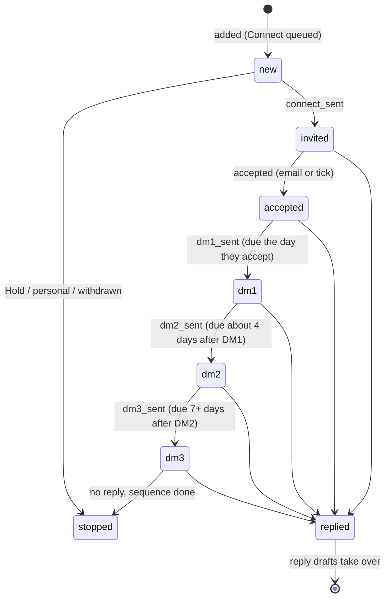

# Data model

Schema only. No rows, no values. Source of truth is the SQL in `native/supabase/` (baseline + migrations); this page is the map.

Prod at the sunset = `baseline/prod_public_schema_2026-10-17_pre0015.sql` (prod after 0014) + migrations 0015 to 0038 + 0041, 0042, 0043, 0045, 0046. Not applied on prod: 0039 (number reserved), 0040, 0044, 0047 to 0052. See [REBUILD.md](REBUILD.md) for the order.

Note on scrubbed names: the column the repo shows as `accounts.why_thrandvex` is named after the seller company in the real database ("why <company>"). Everything else below is named as in the database.

## Core outreach tables

### `people` (one row per prospect)
| Column | Type | Meaning |
|---|---|---|
| `id` | text PK | `P<number>`, assigned in order (`P1`, `P2`, ...) |
| `account_id` | uuid | FK to `accounts` |
| `company`, `owner` | text | company as spelled in Accounts, owning AE |
| `name`, `title`, `linkedin_url`, `role` | text | who they are |
| `route` | text | `Direct` or the exec-track route value |
| `lane` | text | which lane works them: the SDR, the exec track, or the work assistant (check constraint, three values) |
| `connect_day` | date | planned invite day (about 15 per weekday) |
| `stage`, `stage_changed_at` | text, timestamptz | person stage (below) |
| `dm`, `dm2_text`, `dm3_text` | text | current drafts: DM1, DM2, DM3 |
| `connect_sent`, `accepted`, `dm1_sent`, `dm2_sent`, `dm3_sent`, `replied`, `meeting`, `withdrawn` | timestamptz | event times (exact IST time since v18.7.1; a bare date means approximate, listed in `ts_approx`) |
| `dm2_due`, `dm3_due` | date | follow-up due dates (`dm3_due` owned by `scripts/cadence.py`) |
| `next_action` | text | the named next step shown in the app ("Send DM1", "Exec track handoff", ...) |
| `notes` | text | worker notes, one fact per line (`Trigger: <date>, <line>, <url>`, `Ari's pick (dm1): ...`, `Flagged: ...`) |
| `source` | text | where the lead came from (`Apollo`, `CSV upload`, a named import tag) |
| `review` | text | `lead`, `pending`, `personal` |
| `research` | text | `Researching`, `Researching now`, `Draft ready`, `No signal yet`, `Likely personal, review`, `Flagged, no draft` |
| `why_this_person` | text | 1 to 2 sentences: play, pain, why this role (Sheet column `why`) |
| `snooze_until`, `skipped` | date | hide from Today until / removed from Today on |
| `play`, `context` | text | account play; personal context from the SDR that shapes drafts |
| `accepted_source` | text | `gmail` or `manual` |
| `flags` | text[] | hygiene and hold flags |
| `extra`, `field_ts` | jsonb | spare fields; per-field last-write times for the Sheet sync |
| `sheet_row`, `deleted_at`, `created_at`, `updated_at`, `updated_by` | | sync and audit |
| `workspace_id`, `owner_uid` | uuid | tenancy (0033) and pair visibility (0045) |

### Person stages and the cadence

- Stored `people.stage` values: `Connect queued`, `Connect sent`, `Accepted`, `DM1 sent`, `DM2 sent`, `DM3 sent`, `Replied`, `Meeting` / `Meeting set`, `Hold`, `Withdrawn`, plus the exec-track stage. The export to the new system used the simpler names in the diagram (new, invited, accepted, dm1, dm2, dm3, replied, stopped).
- Cadence rules: DM1 the day of the accept. DM2 about 4 days after DM1 (`dm2_due`). DM3 at least 7 days after the actual `dm2_sent` (`dm3_due`, kept by `cadence.py`). Exactly three DMs, then stop. A reply stops the sequence at once. Hold, personal, exec-track and replied people never get SDR DMs.
- Invites older than 14 days used to become "withdraw" items; that was retired in v18.14.8.
- Shift day = IST date minus 6 hours (the SDR worked US hours, so 01:00 IST still counts as the previous day).

### `accounts`
`id` uuid PK, `company`, `owner`, `ae`, `one_liner`, `hook`, `hook_date`, `hook_url`, `why_<seller>` (shown as `why_thrandvex`), `suggested_order`, `status` (`new signal`, `Active`, ...), `play`, `meeting_status`, `meeting_source`, `meeting_date`, `meeting_person`, `meeting_ae`, `meeting_notes`, `domain`, `stage`, `stage_changed_at`, `stage_source` (`ari` or the SDR), `stage_reason`, `stage_override` (bool: the SDR's own move wins), `flags`, `extra`, `field_ts`, `sheet_row`, `deleted_at`, timestamps, `updated_by`, `workspace_id`, `sdr_uid`, `ae_uid`.

Account stages: `Target`, `Researching`, `Mapped`, `Engaged`, `Meeting set`, `Meeting held`, `Opportunity created`, and on the side `Hold`, `Customer`, `Closed lost`, `Not a fit`. Triggers move an account forward from fresh events only (first person = Researching, 4th lead = Mapped, first accept or reply = Engaged, meeting fields = Meeting set / held / Opportunity). Every move is in `account_stage_history` with `kind` `auto`, `manual`, `undo` or `backfill`.

### `account_briefs` (the war room)
`account_id` PK, `company`, `status` (queued, building, ready), `thesis`, `why_now` (jsonb: dated items labelled Verified / Inference / Hypothesis), `data_flow` (jsonb steps), `committee` (jsonb by team: priority P1 to P3, role in the deal, objection, answer), `angle`, `soft_angles`, `quick_check`, `check_answers`, `checked_at`, `check_via` (answered or skip), `sequences` (2 email sequences), `doc_url`, `reviewed_at`, `requested_at`, `built_at`, timestamps.

### `queue` (requests between the app and the worker)
`id` (text; `Q<n>` from the worker, `QA<n>` from the app), `created`, `action`, `target`, `details`, `status` (`queued`, `working`, `done`, `blocked: <reason>`), `result`, `context` (jsonb: screen and entity the request came from), `assumptions` (jsonb, 0046), sync columns.

Queue actions: `Draft DM1/DM2/DM3`, `Draft reply`, `Assign account`, `Add context`, `Chat`, `App change` (closed at write time by a trigger), `Add lead`, `Meeting set`, `Map account` / `Map more people`, `Rescan account`, `Redraft DM`, `Research person`, `Refresh hook`, `Find accounts`, `Draft email`, exec-track send / take back / brief, `New signal`, `AE heads-up`, `Claimable`.

### `replies`
`id`, `person_id`, `account_id`, `gmail_id`, `source`, `received_at`, `msg_count`, `thread_url`, `headline`, `snippet` (the prospect's words when the email carried them or the SDR pasted them), `snippet_source`, `matched_by`, `status` (new, answered, dismissed), `drafts` (jsonb: three drafts keyed `book`, `answer`, `soft`), `drafted_at`, `answered_at`, `answer_body`, `ai_triage` (0041).

### `sent_messages`
What actually went out: `person_id`, `account_id`, `kind` (`dm1`, `dm2`, `dm3`, `reply`, `note`), `body`, `sent_at`, `source`, `original_body`, `edited_at`, `tags`, `draft_tag_id`, `draft_edit_id`, `ari_original`, `edit_diff`. A trigger snapshots the draft the moment a `*_sent` time is set from any path.

### Copy learning
- `draft_tags`: one row per tagged draft: `kind`, `body_md5`, `body`, `angle`, `hook`, `hook_kind` (launch, funding, hire, breach_fine, partnership, mcp_agent, filing, post_talk, product_change, role_pain, peer_move, hypothesis, personal, none), `hook_url`, `hook_date`, `structure`, `journey_step`, `persona`, `play`, `variant`, `created_by`.
- `draft_edits`: the SDR's edit against Ari's original: `original`, `edited`, `diff`, word counts, `saves`, `sent_at`.
- `copy_guidance`: before/after pairs per AE the drafter reads as style guidance.

## Activity and events
- `log_entries`: the human-readable activity log (mirrors the Sheet Log tab). `ts`, `person_id`, `event`, `detail`, `source`, `sheet_key`. Typical `event` values: `Connect sent`, `Accepted`, `Replied`, `Meeting set`, `Exec track handoff`, `Undo ...`, `Ari edit switch`, `Ari edit asset approved`, `Report sent`.
- `events`: append-only, hash-chained (`prev_hash`, `hash`): `ts`, `actor`, `verb`, `person_id`, `account_id`, `payload`.
- `ops`: every app write through `apply_op`: `op_id` (idempotency key), `kind` (`mark`, `undo`, field sets), `target_table`, `target_id`, `payload`, `client_ts`, `device`, `status`, `result`.
- `app.events` (0044, not applied): typed events `connect_sent`, `accept`, `dm_sent`, `reply`, `meeting_booked`, `withdraw`, `profile_scan_done`, `signal_found`, with code or model labels.

## Push
- `push_subscriptions`: web push endpoints with `p256dh`, `auth`, platform, device, `install_id`, health (`last_ok_at`, `last_seen_at`, `last_rx_at`, `failures`, `active`).
- `push_tokens`: native (Expo) tokens, unused after the native app was parked.
- `notifications`: the push queue: `kind` (`accepted`, `replied`, `meeting`, `research_done`, `draft_due`, `digest`, `test`, plus alert kinds), `person_id`, `account_id`, `title`, `body`, `url`, `dedupe_key`, delivery fields. Lock-screen text is generic unless `app_config.push_show_names` is on.

## Gmail
`gmail_connection` (one row: address, Vault secret id of the refresh token, cursor, status), `gmail_oauth_states`, `gmail_connect_tickets`, `gmail_ingest_runs`, `gmail_events` (`msg_id`, `kind` accept or reply, `person_id`, `event_at`, `matched_by`), `gmail_shadow_events`, `gmail_shadow_diffs`, `gmail_watch` (0041).

## Ops, sync and health
- `brief`: key/value strip for the app header (date, opener, focus, heads_up, gmail_last_scan, gmail_confirmed).
- `sync_state`: Sheet sync base snapshots.
- `scan_heartbeat` (one row: last/next scan, running, changes) and `scan_runs` (per book: started, finished, accounts scanned, status).
- `hygiene_findings`: data checks (`check_key`, entity, status, first/last seen, resolution).
- `backup_runs`: each nightly backup (file, bytes, sha256, tables, rows, counts, verified, mismatches, encrypted file and hash, offsite status).
- `ops_row_counts` (0042): daily count per key table.
- `app_config`: key/value flags (below). `ari_prefs`: per-user preferences. `app_usage`: daily seconds and opens.

## Old chat and task tables
`threads`, `messages`, `attachments`, `tasks`, `task_events`, `decisions`, `ari_notes`, `research`, `plays`, `targets`, `app_changes`, `emails`, `book` (the AE books mirrored from the Sheet: `company`, `owner`, `tier`, `flag`, `cluster`, `fit`, `last_checked`, `last_signal`, `website`, `play`). Some of these came from the first native-app schema and were barely used.

## Tenancy (schema `app`)
- `app.workspaces` (`id`, `name`, `timezone`, `settings`) and `app.memberships` (`workspace_id`, `user_id`, `role` (sdr, ae, ...), `status`, `display_name`, `timezone`). One workspace existed, with a fixed id the migrations use.
- `app.pairings` (0045): SDR and AE pairs, for the AE-as-user-two plan that never shipped.
- Every tenant table carries `workspace_id` (NOT NULL, FK, guarded by trigger `ws_guard`).

## AI layer (0041 on prod, unused)
`ai_budget` (one row: `enabled`, monthly and daily caps), `ai_calls` (ledger: task, provider, model, tokens, reserved and estimated cost, status), `ai_jobs` (queued AI work with leases), `ai_triggers`. Not on prod: `pipeline_jobs` and `fact_check_cache` (0047), `ai_chat` (0049), `ai_chat_drafts` (0051), `scan_settings` and `scan_control_runs` (0052), `ari_broker_state` and `ari_broker_mints` (0040).

## Config keys
- **Vault secret names:** `ari_push_hook_secret`, `ari_backup_hook_secret`, `ari_gmail_hook_secret`, `ari_ai_hook_secret`, `ari_vapid_private_jwk`, and one `ari_gmail_refresh_<timestamp>` per Gmail connection.
- **`app_config` keys:** `vapid_public_key`, `push_show_names`, `gmail_fn_base`, `gmail_watch_topic`, `gmail_push_audience`, `gmail_push_sa`, `hygiene_last_scan`, `reply_scan_last`, `today15_cap_per_account`, `ask_draft`, feature flags `today_v3`, `report_v3`, `ui_v4`, `assumptions_ui`, and hygiene check keys (`accept_no_connect`, `duplicate_account`, `no_account_link`).

## Google Sheet tabs (headers only)
Kept as a mirror; template in [config/sheet-template.md](config/sheet-template.md).

## Private working files (not in the repo)
The signal scans and worker also read CSV files that held real accounts. Their columns, so you can recreate them:
- `target_accounts_full.csv`: `owner, account_id, tier, company, website, flag` (non-empty `flag` = customer, open opp or closed lost: no cold outreach).
- `accounts.csv`: `company` plus drops, holds and live leads.
- `signals/target_c_clusters.csv`: company, `cluster`, `fit` (high, med, dead).
- `signals/coverage.csv`: company, `last_checked`, `last_signal`.
- `signals/log.csv`: `date, company, owner, tier, signal, source_url, signal_date, play, persona, status`.
- `config/seller.private.json`: seller name, AE books, allowed proof customers, the one customer never to name, competitors (shape in `scripts/seller_config.py`).
